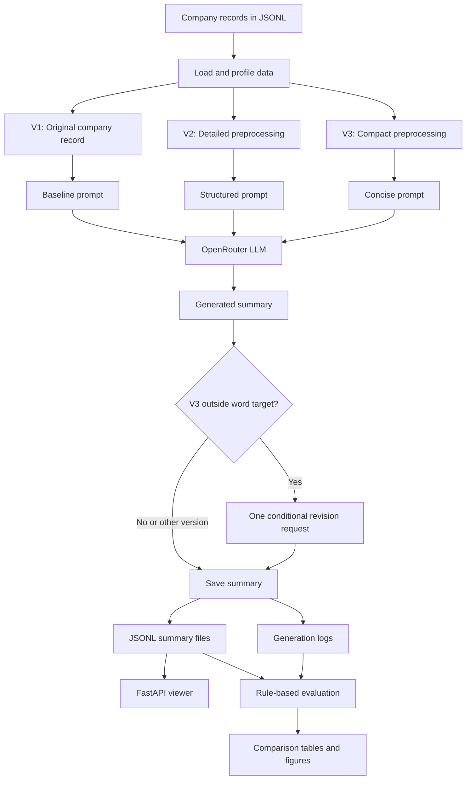
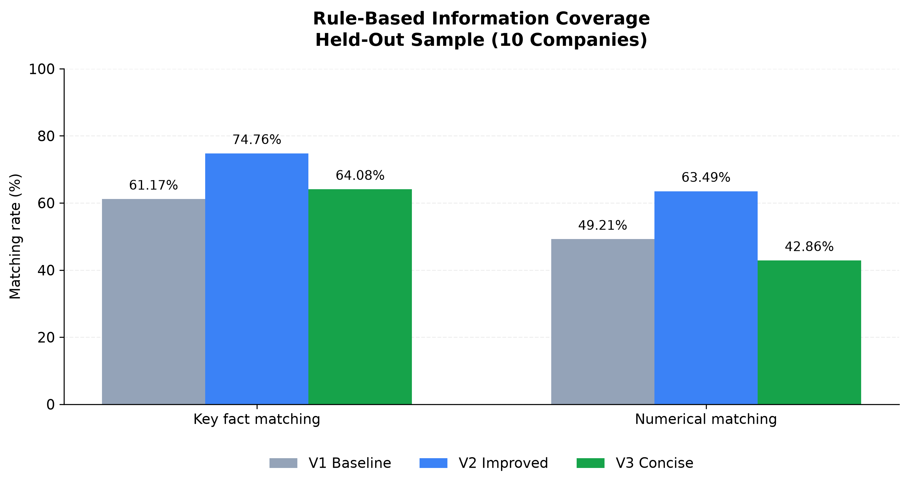
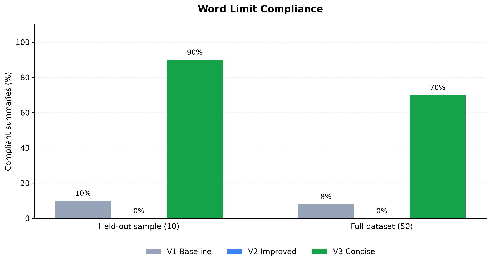
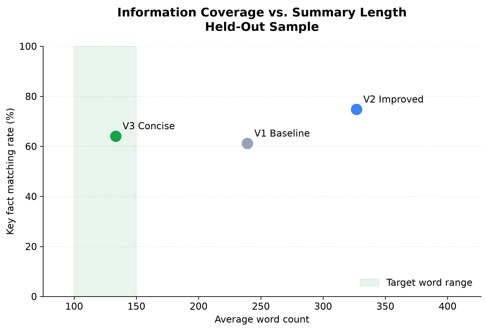
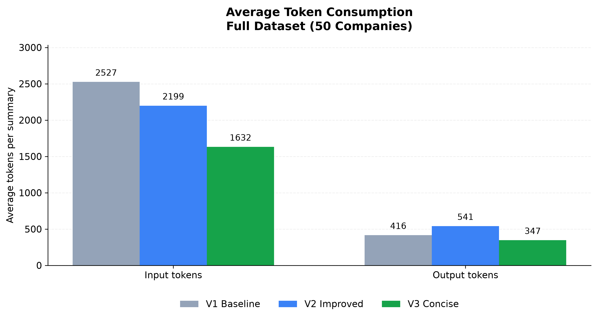

# Company Summarisation for Business Due Diligence

**Author:** Nur Atikah Binti Hussin  
**Assessment version:** 2026.11  
**Development time:** Approximately eight hours, excluding environment setup.

## What a good summary is for this team, and why

The team needs to review companies before selecting suppliers or project partners. Reading the full company record for every screening decision is time-consuming because the records contain company profiles, directors, shareholders, financial statements, audit opinions and litigation information. My objective was to develop a system that turns these records into short, useful summaries that help the reader decide whether a closer review is necessary.

A good summary is not simply a shorter version of the original record. It should prioritise information that could affect the team's next decision while preserving the meaning of the source data. I defined the following quality criteria:

| Criterion | Why it matters |
|---|---|
| Factual correctness | Incorrect financial figures, dates or legal interpretations can mislead the screening team. |
| Material information coverage | Important company characteristics, financial concerns, audit exceptions and litigation should not be overlooked. |
| Relevance | The summary should focus on facts useful for preliminary supplier and partner screening. |
| Conciseness | The reader should be able to understand the company's position without reading another lengthy report. |
| Readability | Clear headings, neutral language and short paragraphs make comparisons easier. |
| Appropriate uncertainty | Missing information and unresolved legal matters should not be presented as established facts. |

I selected a target of 100–150 words as a practical design constraint, not a requirement imposed by OneCredit. The target encourages prioritisation rather than exhaustive reporting. I expected a useful summary to cover the company's identity, status and business activity; its latest available financial position and material changes; and relevant ownership, audit and litigation information.

For example, negative free cash flow may warrant further investigation, but does not independently establish insolvency. Majority ownership is a governance characteristic rather than automatic evidence of financial distress. A pending legal claim is not a confirmed liability, and a company acting as plaintiff should not be treated as if it were a defendant. Missing financial information should be acknowledged rather than interpreted as zero.

The summary is intended to support human review, not to approve or reject a company or replace the underlying record. The implementation initially used credit analyst-oriented prompts as a proxy for financial due diligence. This captures several relevant screening concerns, but does not fully reflect the broader operational needs of supplier and project partner selection. This is an important limitation of the current approach.

## What I built

### Dataset exploration

I first inspected and profiled the supplied `data/companies.jsonl` dataset to understand its structure, completeness and variation. It contains 50 synthetic Malaysian company records as of 31 December 2025. Each record has a registration number, company profile, relationships, financial information and litigation information.

| Dataset characteristic | Count |
|---|---:|
| Total companies | 50 |
| Unique registration numbers | 50 |
| Duplicate registration numbers | 0 |
| Active companies | 48 |
| Companies being wound up | 2 |
| Companies with three financial years | 38 |
| Companies with two financial years | 4 |
| Companies with one financial year | 5 |
| Companies with no financial years | 3 |
| Companies with recorded litigation | 18 |
| Companies without recorded litigation | 32 |

The profiling also identified 11 companies with a latest-year loss, 19 with negative latest-year free cash flow, one with negative latest-year equity and 15 with a latest-year debt service coverage ratio below one. These variations motivated explicit handling of missing financial records, adverse indicators and litigation context. The profiling results are saved in [dataset_profile.csv](evaluation/dataset_profile.csv).

### System architecture

The system uses Python for data processing, deterministic financial calculations, API integration and evaluation. OpenRouter provides access to the generation model through the OpenAI Python SDK. All three final generation versions use the same recorded model, `nvidia/nemotron-3.5-lightning:free`, to reduce model choice as a source of variation. Free API availability and rate limits affected experimentation; other free models were attempted during setup.



### Three summarisation approaches

| Version | Approach | Purpose |
|---|---|---|
| V1 — Baseline | Original company record and a simple prompt | Establish a reference point without specialised preprocessing. |
| V2 — Improved | Detailed deterministic preprocessing and structured instructions | Improve coverage and reduce reliance on model-generated calculations. |
| V3 — Concise | Compact evidence representation, prioritised instructions and conditional revision | Reduce excessive detail while retaining material information. |

#### V1 — Baseline

The baseline sends the original company record directly to the model and asks for a Markdown summary of approximately 100–150 words. It instructs the model to use only the supplied information. This provides a simple reference against which more structured approaches can be compared.

The initial outputs showed that the model could produce readable summaries, but frequently exceeded the target length. It also had to interpret financial changes directly from the raw data, creating opportunities for contextual and arithmetic errors.

Implementation: [generate_baseline.py](src/generate_baseline.py).

#### V2 — Improved preprocessing and structured prompting

V2 transforms the original record into a structured evidence representation before sending it to the model. Python calculates selected financial changes, identifies available reporting periods, summarises ownership and litigation, and extracts relevant audit and financial indicators.

The prompt instructs the model to preserve reporting years, units and signs; distinguish missing values from zero; avoid unsupported explanations; and distinguish litigation roles and statuses. It also specifies five sections covering company overview, financial performance, ownership and governance, audit and litigation, and key considerations.

This approach improved selected information coverage in the initial experiment. However, the detailed evidence and required sections encouraged longer summaries, which reduced suitability for rapid screening.

Implementation: [preprocess.py](src/preprocess.py), [generate_improved.py](src/generate_improved.py).

#### V3 — Compact evidence and concise prompting

V3 was developed after observing the length and coverage trade-off in the earlier experiment. It uses a separate compact preprocessing function to retain the company profile, latest financial metrics, selected financial comparisons, material ownership information, audit exceptions, litigation information and review indicators.

The prompt prioritises material facts, discourages repetition, limits headings and targets approximately 125 words within the 100–150 word range. If the initial output is outside this range, the system can make one revision request using the original evidence and generated summary. It retains the revised summary only if it is closer to the target range. This is a bounded revision mechanism, not a guarantee of compliance or factual correctness.

Implementation: [preprocess_v3.py](src/preprocess_v3.py), [generate_v3.py](src/generate_v3.py). All prompts are available in [prompts.py](src/prompts.py).

### Output, reproducibility and viewer

Each version produced summaries for all 50 companies, giving 150 saved summaries in total. Each JSONL record contains the registration number and Markdown summary in the format required by the viewer:

```json
{"registrationNumber":"SYN-000029","summary":"Company summary in Markdown"}
```

The outputs are available in [v1_baseline.jsonl](summaries/v1_baseline.jsonl), [v2_improved.jsonl](summaries/v2_improved.jsonl) and [v3_concise.jsonl](summaries/v3_concise.jsonl). Generation logs record model identifiers, token usage, latency, word counts and request outcomes. The scripts support resuming generation without repeating completed records.

I successfully opened the provided FastAPI viewer and compared generated summaries alongside the original company information. The viewer was run locally using Uvicorn as an alternative to the Docker setup. It reads the saved summaries without calling the model. The viewer allows a reader to inspect the original profile, ownership, financial and litigation records while comparing summary versions. This verifies basic integration, not the factual quality of every displayed summary.

### Development time and AI assistance

The assessment took approximately eight hours, excluding environment setup. The time was used for data exploration, implementation, prompt development, generation, evaluation, visualisation and analysis. Further experiments were deferred in accordance with the assessment time constraint.

ChatGPT assisted with solution planning, Python code generation, prompt engineering, environment configuration, debugging, evaluation design, visualisation and documentation. OpenRouter provided access to the LLM used for summary generation and experimental LLM-based evaluation. I executed the implementation, examined outputs and experimental results, and iterated on the approach. The source code, saved summaries and evaluation artefacts are included to make the work transparent and reproducible.

## How I know whether it's good

### Experimental design

I used an initial scenario-based split of five development companies, 15 evaluation companies and 30 additional companies. The initial selection covered different financial histories, company statuses, ownership structures, financial concerns and litigation situations. This was intended to expose different failure modes rather than estimate population-level performance.

The initial V1–V2 comparison informed the design of V3. To reduce reuse of the same evaluation examples, I selected a fresh random sample of 10 companies from the 30 additional records using seed 42. The same 10 companies were evaluated for all three versions. This is a held-out sample relative to the initial development and comparison, not an external validation dataset.

The final sample consists of `SYN-001212`, `SYN-000286`, `SYN-000165`, `SYN-001389`, `SYN-000510`, `SYN-000476`, `SYN-001455`, `SYN-000333`, `SYN-001618` and `SYN-000923`. The split definitions are saved in [sample_split.json](evaluation/sample_split.json) and [final_evaluation_split.json](evaluation/final_evaluation_split.json).

### Evaluation metrics

The final evaluation uses deterministic Python checks against the original company records. The checks cover selected company facts, financial figures, ownership, audit opinion and acknowledgement of missing financial data where applicable.

| Metric | Definition |
|---|---|
| Key fact matching | Matched applicable fact checks divided by all applicable fact checks. |
| Numerical matching | Matched applicable numerical checks divided by all applicable numerical checks. |
| Word count | Number of whitespace-separated words in the saved summary. |
| Word limit compliance | Percentage of summaries containing 100–150 words inclusive. |
| Latency | Recorded generation time, including conditional revision overhead where applicable. |
| Token consumption | Recorded input and output tokens, including revision requests where applicable. |

The matching rates are micro-averaged across applicable checks. Numerical checks recognise selected currency, percentage and ratio formats and allow rounding consistent with displayed precision. Missing or inapplicable checks are excluded from the relevant denominator.

These metrics measure selected information coverage, not independently verified factual accuracy. A number can appear in a summary with an incorrect year or interpretation and still match. Conversely, a deliberately omitted non-material figure counts as unmatched. Litigation correctness, practical usefulness and readability are not comprehensively measured by these rules.

### Initial experiment: V1 versus V2

On the initial 15-company evaluation sample, V2 increased key fact matching from 44.23% to 67.95% and numerical matching from 31.25% to 53.12%. However, average summary length increased from 237.27 to 333.73 words, and word limit compliance fell from 6.67% to 0%.

This suggested that detailed preprocessing and structured prompting improved selected information coverage but did not solve the team's need for a short screening summary. The increased length may itself explain part of the coverage improvement. This motivated V3's compact representation and conditional revision mechanism.

### Final held-out comparison

| Metric | V1 Baseline | V2 Improved | V3 Concise |
|---|---:|---:|---:|
| Companies evaluated | 10 | 10 | 10 |
| Matched fact checks | 63/103 | 77/103 | 66/103 |
| Key fact matching | 61.17% | 74.76% | 64.08% |
| Matched numerical checks | 31/63 | 40/63 | 27/63 |
| Numerical matching | 49.21% | 63.49% | 42.86% |
| Average word count | 239.20 | 326.80 | 133.40 |
| Compliant summaries | 1/10 | 0/10 | 9/10 |
| Word limit compliance | 10% | 0% | 90% |
| Average latency (seconds) | 5.16 | 9.16 | 4.91 |
| Median latency (seconds) | 3.80 | 4.39 | 2.08 |
| Average input tokens | 2644.30 | 2276.50 | 1253.30 |
| Average output tokens | 442.90 | 544.80 | 264.80 |
| Recorded API requests | 10 | 10 | 11 |



V2 achieved the highest key fact and numerical matching rates. V3 achieved the highest word limit compliance and retained slightly more matched key facts than V1, improving key fact matching by 2.91 percentage points. However, its numerical matching was 6.35 percentage points lower than V1 and 20.63 percentage points lower than V2.





The results show a trade-off between coverage and brevity rather than a universally superior version. V3 is my preferred candidate for further development as a preliminary screening summary because its length is closer to the intended reading experience. V2 remains preferable when broader selected information coverage is the priority. Neither result establishes that one version is more factually accurate or more useful to actual screening professionals.

#### Final approach selection rationale

Relative to V2, V3 reduced average held-out summary length by approximately 59.18% and increased word limit compliance from 0% to 90%, at the expense of 10.68 percentage points in key fact matching and 20.63 percentage points in numerical matching. This is a provisional business-oriented choice: V3 is better suited to the intended length constraint, while V2 retains more selected information. Independent reviewers must establish whether V3's omissions affect screening decisions before it can be preferred operationally.

### Full-dataset operational comparison

| Metric | V1 | V2 | V3 |
|---|---:|---:|---:|
| Completed summaries | 50 | 50 | 50 |
| Completion rate | 100% | 100% | 100% |
| Average word count | 228.34 | 325.08 | 141.66 |
| Minimum–maximum words | 113–414 | 227–450 | 98–200 |
| Compliant summaries | 4 | 0 | 35 |
| Word limit compliance | 8% | 0% | 70% |
| Average latency (seconds) | 3.68 | 5.12 | 5.36 |
| Average input tokens | 2527.02 | 2199.06 | 1632.38 |
| Average output tokens | 416.40 | 541.34 | 346.92 |
| Recorded API requests | 50 | 50 | 69 |

V3 reduced average summary length by approximately 38% relative to V1. Its average input token usage was approximately 35% lower, despite the additional revision requests. The revision mechanism increased compliance from 31 initial compliant summaries to 35 final compliant summaries, using 19 additional recorded requests. This modest improvement suggests that revision is useful in some cases but could be made more efficient.



Although V3 had the lowest average latency on the held-out sample, it had the highest average latency across the full dataset. The recorded times include revision overhead and are affected by API provider variability. I did not measure monetary cost or conduct controlled latency benchmarking, so these results should not be interpreted as guaranteed production performance.

### Illustrative factual review

One example demonstrates why information matching alone is insufficient. For Cahaya Seri Catering Sdn. Bhd. (`SYN-000286`), the source record shows profit after tax increasing from RM173,231 in 2022 to RM178,923 in 2024, an increase of approximately 3.29% over the two reporting years.

V1 included both figures but described the change as a decrease and suggested that the later figure was an outlier without supporting evidence. This is a contextual error despite the presence of correct numerical values.

V2 covered the company's financial and litigation information in greater detail, but contained 341 words. V3 reduced the summary to 142 words and retained important facts including negative free cash flow, ownership concentration, the audit opinion and two pending defendant cases. However, it omitted the debt service coverage ratio and the recorded judgment-entered case. Those omissions could matter to a screening team.

| Assessment aspect | V1 Baseline | V2 Improved | V3 Concise |
|---|---|---|---|
| Financial interpretation | Incorrect profit trend direction | Reported latest financial figures | Retained selected latest financial figures |
| Unsupported interpretation | Unsupported outlier claim | Not systematically assessed | Not systematically assessed |
| Litigation coverage | Not systematically assessed | More detailed case coverage | Prioritised two pending defendant cases; omitted judgment-entered case |
| Word count | 260 | 341 | 142 |
| Key fact matching | 45.45% | 81.82% | 72.73% |
| Numerical matching | 28.57% | 71.43% | 57.14% |
| Within target length | No | No | Yes |

This example illustrates both the benefits and limitations of compression. It is a targeted inspection, not a systematic independent factual quality review or an estimate of the overall error rate.

### Experimental LLM-based evaluation

I also attempted to assess factual correctness, unsupported claims, material coverage and readability using an LLM as a judge. The initial V1–V2 experiment produced scores, but some judgements were inconsistent with the underlying financial evidence. The same model was used for generation and judging after alternative free-model access encountered rate limits, introducing potential self-evaluation bias.

Three subsequent attempts to complete the final evaluation encountered different problems: repetitive claim counts and invalid JSON, excessively long or truncated structured responses, and invalid material fact identifiers even after simplifying the task to one summary per request.

I therefore excluded the incomplete and unreliable final judge results from the reported comparison. The experimental artefacts are retained for transparency, but are not used as evidence of factual accuracy. A systematic independent factual review was not completed within the eight-hour time constraint.

### Reproducing the final evaluation

The final rule-based results can be reproduced from the saved summaries without additional LLM requests:

```bash
uv sync --locked
uv run python src/profile_dataset.py
uv run python src/verify_final_samples.py
uv run python src/evaluate_rules_final.py
uv run python src/evaluate_final.py
uv run python src/visualise_final.py
```

The main evidence is available in [final_comparison.csv](evaluation/final_comparison.csv), [full_dataset_comparison.csv](evaluation/full_dataset_comparison.csv), [final_rule_based_scores.csv](evaluation/final_rule_based_scores.csv) and [final figures](evaluation/final_figures/). The full-dataset comparison measures operational characteristics; the matching results are based on the 10-company held-out sample only.

## What I Will do next, and how I Will keep improving it

### 1. Establish an independent quality benchmark

My first priority would be to validate summary quality against the original company records using a structured review by independent reviewers, ideally including people familiar with supplier and project partner screening. I would select a larger sample covering missing data, winding-up status, unusual audit opinions, financial concerns and complex litigation.

Reviewers would assess factual correctness, material information coverage, relevance, conciseness and readability. I would record individual claims and their supporting source fields, distinguish omissions from incorrect or unsupported statements, and use a shared rubric to improve consistency. A separate evaluation set would be reserved for testing subsequent improvements.

### 2. Align the prompts with the actual business audience

The current prompts focus on credit analysis. I would revise the role and content priorities to explicitly support supplier and project partner screening. Financial health would remain important, but business activity, operational suitability, company status, governance and legal matters would be prioritised according to the team's actual needs. I would test the revised prompt on the same development examples before evaluating it on fresh records.

### 3. Improve factual validation and materiality-aware coverage

The current matching rules do not verify that a number is associated with the correct metric, reporting year or interpretation. I would add checks for financial trend direction, profit versus loss, reporting periods, audit exceptions, litigation roles and case statuses. I would also introduce materiality-aware checks so that omitting an important pending legal matter is treated differently from omitting a routine financial ratio.

A structured intermediate representation with explicit evidence references could support validation before rendering the final Markdown summary. Any failed validation should trigger a bounded correction attempt or flag the output for human review rather than silently accepting an unreliable summary.

### 4. Improve conciseness without losing important facts

V3 achieved 90% word limit compliance on the held-out sample but only 70% across the full dataset. Its lower numerical coverage and the omitted facts in the illustrative example show that brevity alone is not enough.

I would refine the compact preprocessing and prioritisation rules, preserve essential facts for high-complexity companies, and test a more controlled output structure. I would also measure whether revision requests provide sufficient quality improvement to justify their additional latency and token consumption.

### 5. Improve evaluation reliability and operational monitoring

If LLM-based evaluation is revisited, I would use an independent judge model where feasible, a small fixed evaluation rubric, strict schema validation and calibration against human-reviewed examples. I would not rely on the judge's scores until its agreement with independent reviews had been established.

For operational use, I would monitor generation completion, factual validation failures, material omissions, summary length, token consumption, latency and provider errors. Changes to prompts, preprocessing and models would be versioned and evaluated against a fixed regression dataset, with fresh examples used for final comparisons. User feedback from the screening team would guide which information should be prioritised.

### Proposed acceptance criteria for future iterations

I would agree on a claim-level and material-fact rubric with the screening team before testing new versions. The following are provisional targets for discussion, not achieved results or OneCredit requirements.

| Metric | Proposed target |
|---|---|
| Independently verified factual accuracy (supported correct claims / all verifiable claims) | At least 98% |
| Critical factual errors (errors that could materially mislead screening) | Zero observed in the acceptance sample |
| Material information coverage (correctly represented required facts / applicable required facts) | At least 90% |
| Word limit compliance | At least 95% |
| Generation completion rate | At least 99% |
| Mean reviewer usefulness rating | At least 4 out of 5 |

I would report sample sizes and uncertainty alongside these metrics. Zero observed critical errors would not establish zero production risk. Conciseness improvements should be accepted only if factual correctness and material coverage remain satisfactory.

### Current limitations and conclusion

The versions change multiple components simultaneously, including preprocessing, prompt structure and conditional revision. Consequently, their differences cannot be attributed to a single component independently. A future ablation study would compare raw and preprocessed evidence under the same prompt, alternative prompts under the same evidence representation, and generation with and without revision while holding the model and evaluation sample fixed.

The dataset is synthetic and the final held-out evaluation contains only 10 companies. The rule-based metrics measure selected information matching, not comprehensive factual correctness. The LLM judge experiments were inconclusive, and independent assessment of practical usefulness and readability remains outstanding. V3 still has 15 summaries outside the target word range, and its compact representation can omit relevant details. The prompts also need closer alignment with the actual supplier and project partner screening audience.

Within the assessment time limit, the project demonstrates a complete, reproducible workflow from structured company records to saved Markdown summaries, with three comparable approaches and an operational viewer. The results show that the detailed-preprocessing approach achieved higher selected information coverage, while the compact, length-focused approach achieved better conciseness. V3 is a promising starting point for further screening-oriented development, but independent factual and business validation is necessary before production use.
