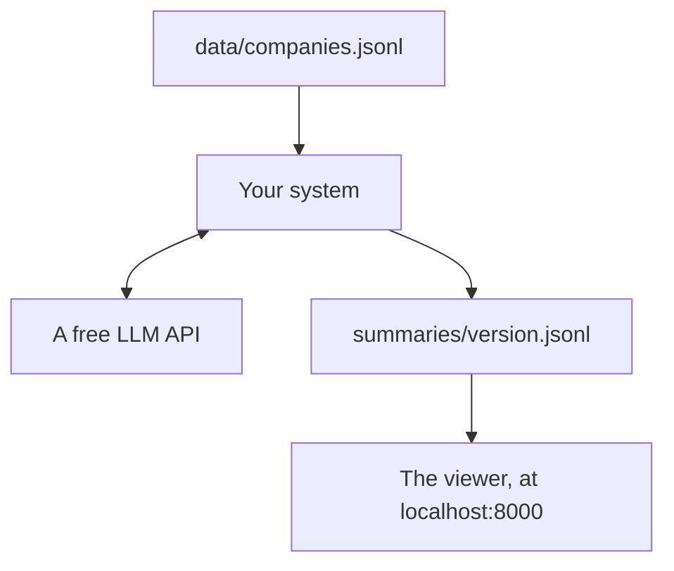
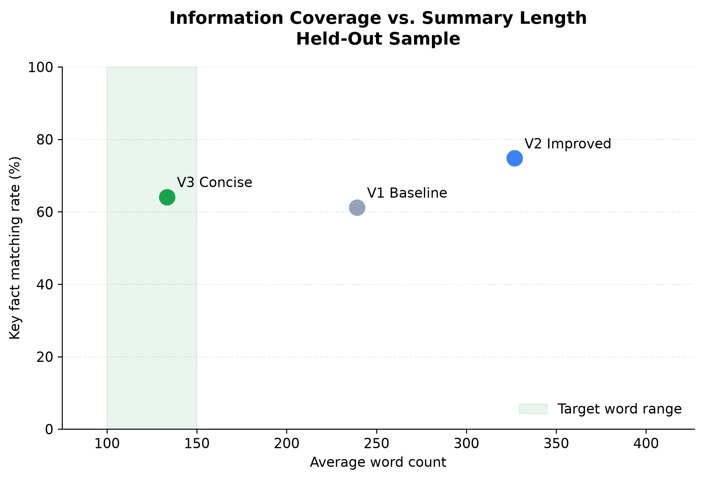

# DS Take-Home: Company Summaries

**tl;dr:** Build a system that writes a short summary of a company, then write a case study on how you built it and how you know it works. We give you 50 companies, and you can use all of them or just a sample. Plan for 6 to 8 hours, ideally over a weekend. Free LLM APIs are all you need.

**Who it's for:** early-career data scientists with 0 to 2 years of experience. Fresh graduates are very welcome.

If you're not applying and just want to try it, go for it. We hope you learn something new.

## What to submit

1. A **public** repo made from this template. Click **Use this template** → **Create a new repository**, and call it
   whatever you like.
2. Your summaries in [`summaries/`](summaries/), one `<version>.jsonl` file per version ([format](#the-viewer)).
3. A `CASE_STUDY.md` at the top level of your repo, with these headings:
   1. What a good summary is for this team, and why
   2. What you built
   3. How you know whether it's good
   4. What you'd do next, and how you'd keep improving it
4. The [submission form](https://docs.google.com/forms/d/e/1FAIpQLSdjCsXP5jFrKrIi4krLVS8Sq0rhM4mLlhycpsAo34sSj4h3FA/viewform), with a link to your repo and your résumé.

## How we score

- How you decided what a good summary is.
- How you know your system is good.
- How clearly you explain your work and what you'd do next.

Stop at 8 hours. If you run out of time, write down what you'd do next. An honest "here's what's left" counts in
your favour, and we don't expect a perfect or finished solution.

## The problem

A team vets companies before picking them as suppliers or project partners. For every company they read a long
record: its profile, its directors and shareholders, up to three years of financials, and any court cases. That takes
a while. They'd like a short summary to read first, so they can decide whether a company is worth a closer look.

```
┌────────────────────────────────────────────────────────────────────────────────┐
│  Cahaya Seri Catering Sdn. Bhd.                                   SYN-000286   │
│  Food & Beverage · Sabah                                                       │
│  Overview & Relationships   Directors & Shareholders   Financials   Litigation │
├────────────────────────────────────────────────────────────────────────────────┤
│                                                                                │
│  Summary                                                                       │
│  ┌──────────────────────────────────────────────────────────────────────────┐  │
│  │                                                                          │  │
│  │          What your system writes about this company goes here.           │  │
│  │                                                                          │  │
│  └──────────────────────────────────────────────────────────────────────────┘  │
│                                                                                │
│  The full record: profile, people, financials and court cases                  │
│                                                                                │
└────────────────────────────────────────────────────────────────────────────────┘
```

## Your task

Build a system that writes that summary for the companies in [`data/companies.jsonl`](data/companies.jsonl). How
would you build it, experiment with it and evaluate it? Do it, then tell us about it in your `CASE_STUDY.md`.

There are 50 companies, but you don't have to use them all. If a sample suits your plan or your model's limits, use a
sample, and tell us in your case study which companies you picked and why.

What makes a summary good is up to you. Working that out is part of the problem, and there isn't one right answer.
We'd rather see one idea taken all the way than lots of ideas started.



## Models

Use any free LLM API. [awesome-free-llm-apis](https://github.com/mnfst/awesome-free-llm-apis) lists providers with
free tiers, and most of them don't need a credit card. Free tiers are small and change often, so check a provider's
limits when you sign up and plan your runs around them.

To help you plan: one company's record is about 2,000 tokens, so a pass over all 50 is roughly 100,000 tokens. That
goes up two or three times if your model reasons before it answers, or if you use a model to check the output. On a
lot of free tiers, that's most of a day's allowance. Save every response you get back, so you can score your
summaries again without calling the model again.

A paid key is fine too, and it won't change your score. Tell us which provider and models you used in your case
study.

## Getting started

You need Docker, [uv](https://docs.astral.sh/uv/) (it installs Python 3.14 for you) and
[just](https://github.com/casey/just). Setup takes about 5 minutes and doesn't count towards your time. The first
`just up` also downloads the app image, which can add a minute.

```bash
just setup      # install the dependencies on your machine
just up         # start the viewer at http://localhost:8000
just down       # stop it
just lint       # check the viewer's code (app/) with Ruff and Pyrefly
```

If port 8000 is taken, set `APP_PORT` before `just up`. `just lint` only checks the viewer, and nothing runs it
automatically, since this repo has no CI.

If the setup itself is broken (Docker, the viewer or the data won't start), open a
[Setup problem](https://github.com/OneCreditMY/ds-take-home/issues/new?template=setup-problem.yml) issue. Issues are public, so please leave
your solution and personal details out of it.

## The viewer

The viewer shows each company's record with your summaries next to it. Save each version of your summaries as its
own file in [`summaries/`](summaries/), named `<version>.jsonl`, with one line per company:

```json
{"registrationNumber": "SYN-000029", "summary": "Your summary, in Markdown"}
```

Refresh the page to see a new file, and pick a second version to compare the two side by side. The viewer only reads
files and never calls a model. Its code is in [`app/`](app/), and you can change it as much as you like.

## The data

[`data/companies.jsonl`](data/companies.jsonl) has one company per line, 50 in all, and the records are as of
31 December 2025.

| Field | What's in it |
|---|---|
| `registrationNumber` | The company's ID: `SYN-` and six digits. |
| `profile` | Name, status, type, incorporation date, industry, state, nature of business, share capital and former names. |
| `relationships` | Directors (designation and appointment date) and shareholders (people or companies, with their percentage). People are named by role, such as `Director 1` or `Shareholder 2`; a director who also holds shares has the same name in both lists. |
| `financials.years` | Each financial year's audit firm and opinion, `statements` (amounts in RM) and `ratiosAndMetrics`: ratios as decimals (0.12 is 12%) in four groups, profitability, liquidity and cash flow, operational efficiency, and capital structure. A ratio is `null` when it can't be calculated. |
| `litigation.cases` | Court cases: case number, whether the company is the plaintiff or the defendant, type, court, filing date, status and claim amount in RM. |

## What's already here

```
.
├── data/companies.jsonl   # the records for 50 synthetic companies, one per line
├── summaries/             # your system's summaries, one file per version
├── app/                   # the viewer: a small FastAPI backend and one HTML page
├── docker-compose.yml     # runs the viewer, reloading when app/ changes
└── Justfile               # setup, up, down, lint
```

Write your solution in Python, in this project's environment. Add any libraries you need with `uv add`.

## Using AI tools

Go ahead. Just tell us in your case study which tools you used and what for. In the interview we'll ask you to walk
us through your work, so make sure you understand everything you hand in.

## After you submit

- We'll review your work as soon as we can.
- If we move forward, the next interview is a short presentation of your case study (as a slide deck), then
  questions.
- Either way, you'll get written feedback by email.
- Your repo stays yours. Keep it public as a portfolio piece if you like.

## About the data

Everything in this repo is synthetic. We made it up for this assessment.

- The companies, registration numbers, financial figures and court cases are all invented. Any resemblance to a real
  company is a coincidence.
- People and audit firms have placeholder names, like `Director 1` and `Audit Firm 3`, never real ones.
- There's no OneCredit customer, credit or production data in this repo, and none was used to create it.
- Registration numbers (`SYN-`) and case numbers (`CASE-`) use made-up formats, so they can't be mistaken for real
  Companies Commission of Malaysia (SSM) or court numbers.
- Your copy is public, so keep secrets, credentials and personal data out of it.

Assessment version: **2026.11** (`ds-v2026.11`). You can see what changed between versions in
[`CHANGELOG.md`](CHANGELOG.md).

---

# Solution Implementation

## Project Overview

This project presents an experimental large language model (LLM) based approach to company summarisation for preliminary supplier and project partner screening. The generation prompts originally target credit analysts; adapting them more directly to business due diligence remains a future improvement.

| Version | Approach |
|---|---|
| V1 — Baseline | Direct summarisation of the original company record. |
| V2 — Improved | Deterministic financial preprocessing and detailed prompts. |
| V3 — Concise | Compact preprocessing, information prioritisation and one conditional length revision. |

Each approach was applied to all 50 synthetic company records, resulting in 150 saved summaries. The 100–150-word target is a project design choice, not an assessment requirement.

## Technology Stack

Python, OpenRouter, `nvidia/nemotron-3.5-lightning:free`, OpenAI Python SDK, python-dotenv, Pandas, Matplotlib, FastAPI, uv, JSONL and CSV.

## Installation

From the repository root:

```bash
uv sync --locked
```

To generate new summaries, create a local `.env` file using `.env.example` as a reference:

```env
OPENROUTER_API_KEY=your_api_key_here
MODEL_ID=nvidia/nemotron-3.5-lightning:free
```

The `.env` file and API credentials must not be committed to the repository. The saved summaries, viewer and final rule-based evaluation do not require an API key.

## Running the Viewer

Use the original Docker-based workflow:

```bash
just up
```

Open http://localhost:8000. Alternatively, run the FastAPI application directly from the repository root:

```bash
uv run uvicorn app.main:app --host 127.0.0.1 --port 8001
```

Open http://localhost:8001. Select a company and two summary versions to compare. Keep the terminal running; press Ctrl+C to stop the direct server. For Docker, use `just down`.

## Generating Summaries

The generated outputs are included in `summaries/`. To generate missing summaries:

```bash
uv run python src/generate_baseline.py --split all
uv run python src/generate_improved.py --split all
uv run python src/generate_v3.py --split all
```

The generation scripts support resumption from previously saved outputs. These commands do not overwrite completed summaries. Model availability and provider rate limits may change. Preserve existing outputs and logs when conducting new experiments.

## Reproducing the Evaluation

The following commands use saved summaries and generation logs without additional LLM requests:

```bash
uv run python src/profile_dataset.py
uv run python src/verify_final_samples.py
uv run python src/evaluate_rules_final.py
uv run python src/evaluate_final.py
uv run python src/visualise_final.py
```

The initial development and evaluation splits are recorded in `evaluation/sample_split.json`. The final held-out sample is recorded in `evaluation/final_evaluation_split.json`. The final comparison uses the same 10 companies for all three versions.

## Repository Structure

```text
.
├── app/                         # Original viewer
├── data/companies.jsonl         # Source records
├── src/                         # Generation, preprocessing and evaluation
├── summaries/
│   ├── v1_baseline.jsonl
│   ├── v2_improved.jsonl
│   └── v3_concise.jsonl
├── evaluation/                  # Saved metrics, splits, logs and figures
├── CASE_STUDY.md                # Methodology and findings
├── README.md
├── .env.example                 # Configuration placeholders only
├── pyproject.toml
└── uv.lock
```

## Results

### Final held-out evaluation (10 companies)

| Metric | V1 | V2 | V3 |
|---|---:|---:|---:|
| Key fact matching | 61.17% | 74.76% | 64.08% |
| Numerical matching | 49.21% | 63.49% | 42.86% |
| Average word count | 239.20 | 326.80 | 133.40 |
| Word limit compliance | 10% | 0% | 90% |
| Average latency | 5.16 s | 9.16 s | 4.91 s |



### Full dataset (50 companies per version)

| Metric | V1 | V2 | V3 |
|---|---:|---:|---:|
| Completed summaries | 50 | 50 | 50 |
| Average word count | 228.34 | 325.08 | 141.66 |
| Word limit compliance | 8% | 0% | 70% |
| Average latency | 3.68 s | 5.12 s | 5.36 s |
| Recorded API requests | 50 | 50 | 69 |

V2 achieved the highest matching rates for selected information. V3 was identified as the preferred candidate for further development when concise preliminary review is the priority, although it retained fewer of the selected numerical facts. Its revision mechanism improves length compliance at the cost of additional requests.

Matching rates measure selected information coverage, not independently verified factual accuracy. The final LLM judge experiments were incomplete and are excluded from the final comparison. The system has not undergone systematic independent factual validation.

## Evaluation Artefacts

- [Dataset profile](evaluation/dataset_profile.csv)
- [Final evaluation comparison](evaluation/final_comparison.csv)
- [Full dataset comparison](evaluation/full_dataset_comparison.csv)
- [Company-level rule-based results](evaluation/final_rule_based_scores.csv)
- [Final visualisations](evaluation/final_figures/)

## Historical Experiments

The [initial V1–V2 experiment](evaluation/v1_v2_experiment/) informed the development of V3. The directories [judge attempt 1](evaluation/judge_attempt_1/), [judge attempt 2](evaluation/judge_attempt_2/) and [judge attempt 3](evaluation/judge_attempt_3/) retain incomplete LLM-based evaluation artefacts for transparency. These judge results are excluded from the final comparison. Earlier experimental scripts may require their original output paths to be restored; use the final evaluation commands above for reproducibility.

## Case Study and AI Assistance

See [CASE_STUDY.md](CASE_STUDY.md) for the methodology, design decisions, limitations, development time and future improvements.

ChatGPT was used to assist with solution planning, code development, prompt engineering, debugging, evaluation, visualisation and documentation. OpenRouter provided access to the generation model and the model used in experimental LLM-based evaluation.

## Acknowledgement

This submission was developed using the OneCredit Data Scientist Take-Home Assessment template, version 2026.11. All supplied company records are synthetic.
